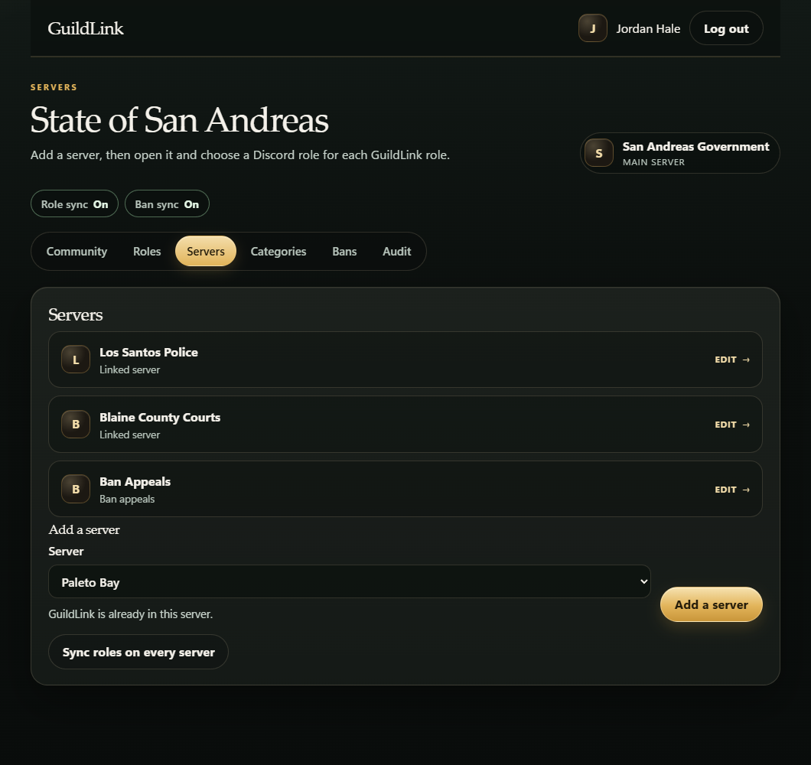
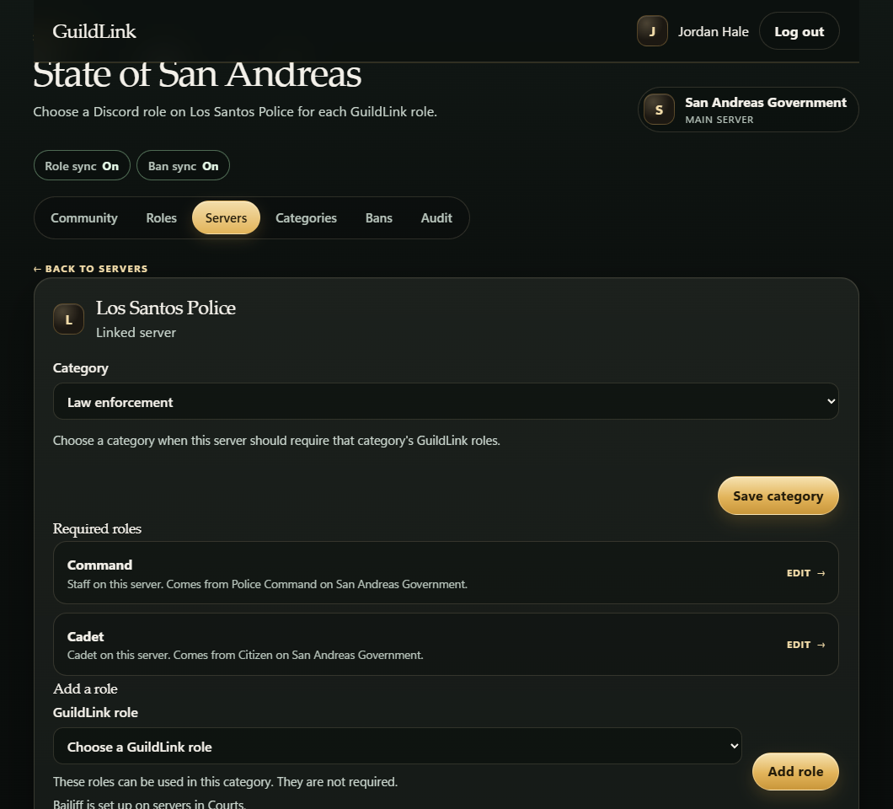
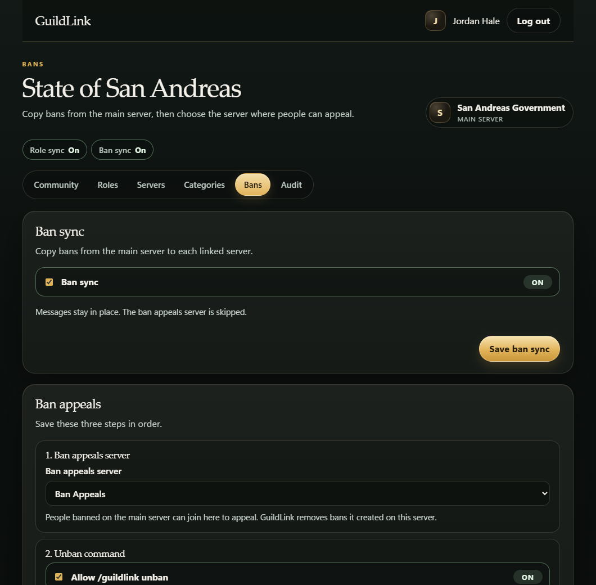

# GuildLink

Discord bot and web panel for one roleplay community. You host GuildLink yourself. Each install has one main server and the linked servers that belong with it.

A role on the main server can grant different roles on each linked server. It is not a copy of the same role. Someone with Moderator on the main server might receive Staff on one server and Bailiff on another. If two main-server roles grant the same role, that role stays until both are gone.

A ban on the main server is copied to every linked server except the ban appeals server. The reason stays on the main server. Each linked server records `[GuildLink] Banned from {main server}`. People banned on the main server can still join the appeals server. Unbanning them on the main server removes bans GuildLink created. A ban that was already on a linked server is left alone, including its reason.

The bot does not create Discord servers. Create the servers yourself, invite GuildLink, then link them in the panel.

The community home shows the name and settings. GuildLink roles live on the Roles page. Linked servers live on the Servers page. Categories live on the Categories page. Ban sync, the ban appeals server, and who may run `/guildlink unban` live on the Bans page. The audit log lives on the Audit page.





Each linked server chooses the Discord role for a GuildLink role. A category can require roles, and other roles can be added on that server.



Ban sync copies a main-server ban to the linked servers. The ban appeals server is where people can appeal, and chosen roles there can run `/guildlink unban`.

## Who can change what

Access is based on the Discord **Administrator** permission, or owning the server. Manage Server on its own is not enough.

- **Administrator on the main server** can change the community and every linked server. That includes which roles sync, the role map on each server, which servers are linked, optional categories for linked servers, which categories a main role links on, which server is used for ban appeals, which roles there may run `/guildlink unban`, and bans.
- **Administrator on a linked server, but not the main server,** can change only the linked servers they administer. They can set which local roles a main-server role grants, which roles on their server grant a main-server role, which roles on their server grant roles on the main server, and which local role fills each required category slot. They can see the category and whether its requirements are met. They cannot change other servers, add or remove servers, choose which main-server roles exist, create or edit categories, choose a server's category, choose which categories a role links on, turn ban sync on or off, or turn the appeals unban command on or off.

## Setup

1. Create an application in the [Discord Developer Portal](https://discord.com/developers/applications).
2. Open **Bot** and copy the token. Turn on the privileged **Server Members Intent**.
3. Open **OAuth2** and add this redirect: `http://localhost:3000/auth/callback`
4. Copy the application id and client secret.
5. Copy `.env.example` to `.env` and fill it in. `SESSION_SECRET` should be a long random string.
6. Install and start:

```bash
npm install
npm start
```

7. Open `http://localhost:3000`, sign in with Discord, and invite the bot from the panel.
8. On every server, drag the GuildLink role above the roles it needs to assign. It also needs permission to ban members on the linked servers.
9. Set up the one community from the main server, link the others, choose the main-server roles to sync, then tick what each role grants on each server. A role on a linked server can also be ticked so that having it grants the main-server role. A role that exists only on a linked server can sync too: choose it under "Sync from this server", then tick what it grants on the main server and on the other linked servers.

The database is stored outside the project by default, under `%LOCALAPPDATA%\guildlink\guildlink.db`, so OneDrive does not lock it.

## What the bot does

- A main-server administrator can group linked servers into optional categories. A category can list required roles, and each required role can list Discord permissions. Both are optional while you set the category up. Once a server uses that category, every role and permission you added is required for that server: each slot needs a local role, and that role needs the permissions you ticked. Administrator on the Discord role covers every permission. GuildLink checks the role and reports anything missing. It does not change Discord permissions.
- A tracked main-server role can be limited to one or more categories. With no categories ticked, it links on every server. With categories ticked, it links only on servers in those categories. A server with no category, or a server in another category, keeps its other roles. GuildLink stops granting from a link that is outside the allowed categories, and it leaves roles it did not add.
- When someone gains or loses a synced role on the main server, GuildLink updates the mapped roles on linked servers where that person is a member.
- A role on a linked server can grant a main-server role. Someone with Police on the police server can receive a role on the main server, and then the roles that role grants on the other servers. Removing that linked role removes the main-server role GuildLink added. A main-server role the person already had is left in place.
- A role does not have to exist on the main server to sync from a linked server. Holding that linked role grants the roles you tick on the main server and on other linked servers. GuildLink only removes roles it added for that sync.
- When they leave the main server, those mapped roles are removed. Their other roles stay.
- When they join a linked server, GuildLink applies the map. If they are banned on the main server, it bans them instead, unless that server is the ban appeals server.
- Bans do not delete messages on the linked servers.
- Choosing a ban appeals server removes bans GuildLink already applied there, so banned people can join and appeal. Role sync still runs on that server. Clearing the choice copies main-server bans to it again while ban sync is on. A ban that was already on that server, and was not created by GuildLink, stays.
- A main-server administrator can allow `/guildlink unban` in the ban appeals server. It is off until they turn it on. They also choose which roles on that server may use it. An administrator there can run it only when they have one of those roles. Until a role is ticked, nobody can. GuildLink then removes the main-server ban and the bans it created on the other servers.
- Turning sync off stops future updates. It does not undo roles or bans already applied.
- Removing a server from the community leaves Discord roles and bans in place. Deleting the community clears it from this GuildLink so it can be set up again. Roles and bans on Discord stay.

`/guildlink status`, `/guildlink sync-roles`, `/guildlink sync-bans`, and `/guildlink unban` are available to Administrators. Ban sync from the command is limited to administrators of the main server. `/guildlink unban` only works in the ban appeals server, only after it is turned on in the panel, and only for an administrator who has a role selected for it. Role sync from a linked server only updates that server, unless the person is also an administrator of the main server. Restart GuildLink after updating so Discord picks up the new command.

## Checks

```bash
npm test
```
